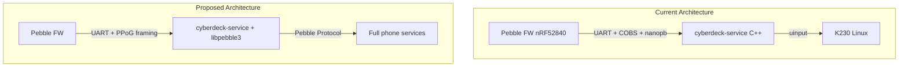

# Feasibility: libpebble3 on K230 as Pebble "Phone"

## Architecture Summary

### Current Protocol Stack
| Layer | nRF → K230 | K230 → nRF |
|-------|-----------|-----------|
| Application | [NrfToK230](file:///store/git/cyberdeck-service/src/pebble/k230_protocol.proto#10-17) (keyboard, touchpad, heartbeat) | [K230ToNrf](file:///store/git/cyberdeck-service/src/pebble/k230_protocol.proto#19-25) (ack, shutdown) |
| Serialization | nanopb (protobuf) | nanopb |
| Framing | COBS + CRC8 | COBS + CRC8 |
| Physical | UART 115200 | UART 115200 |

### Pebble Comm Stack (phone ↔ FW)
| Layer | Phone (libpebble3) | Firmware |
|-------|-------------------|----------|
| Application | Services (BlobDB, AppMessage, etc.) | Endpoint handlers |
| Protocol | Pebble Protocol (4-byte header: len + endpoint) | CommSession |
| Transport | PPoG (Data/Ack/Reset, seq numbering, windowed) | PPoGATT client |
| Physical | BLE GATT (notifications + writes) | BLE GATT |

---

## Q1: Can libpebble3 (Kotlin) run on Linux outside a smartphone app?

**Yes, with effort.** libpebble3 is a [Kotlin Multiplatform](file:///store/git/cyberdeck-service/mobileapp/libpebble3/build.gradle.kts#L84) project that already has a `jvm()` target. Key findings:

- ✅ **JVM target exists** — `jvm()` declared in [build.gradle.kts](file:///store/git/cyberdeck-service/mobileapp/libpebble3/build.gradle.kts#L84)
- ✅ **PPoG protocol is in `commonMain`** — all packet handling ([PPoGPacket.kt](file:///store/git/cyberdeck-service/mobileapp/libpebble3/src/commonMain/kotlin/io/rebble/libpebblecommon/connection/bt/ble/ppog/PPoGPacket.kt), [PPoG.kt](file:///store/git/cyberdeck-service/mobileapp/libpebble3/src/commonMain/kotlin/io/rebble/libpebblecommon/connection/bt/ble/ppog/PPoG.kt)) is transport-agnostic
- ✅ **Pebble Protocol layer is transport-agnostic** — [PebbleProtocolRunner](file:///store/git/cyberdeck-service/mobileapp/libpebble3/src/commonMain/kotlin/io/rebble/libpebblecommon/connection/PebbleProtocolRunner.kt) reads from `ByteChannel`, not from BLE directly
- ⚠️ **jvmMain BLE is stubbed** — [PebbleBle.jvm.kt](file:///store/git/cyberdeck-service/mobileapp/libpebble3/src/jvmMain/kotlin/io/rebble/libpebblecommon/connection/bt/ble/pebble/PebbleBle.jvm.kt) has `TODO("Not yet implemented")`
- ⚠️ **Dependencies** — Room (SQLite), Kable (BLE), Compose UI, Ktor are pulled in; some may need platform stubs for headless Linux

> [!IMPORTANT]
> The core PPoG + Pebble Protocol code runs on JVM, but you'll need a custom [TransportConnector](file:///store/git/cyberdeck-service/mobileapp/libpebble3/src/commonMain/kotlin/io/rebble/libpebblecommon/connection/TransportConnector.kt#74-79) implementation that speaks UART instead of BLE GATT. The [PPoGPacketSender](file:///store/git/cyberdeck-service/mobileapp/libpebble3/src/commonMain/kotlin/io/rebble/libpebblecommon/connection/bt/ble/ppog/PPoG.kt#22-26) interface (just [sendPacket(ByteArray)](file:///store/git/cyberdeck-service/mobileapp/libpebble3/src/commonMain/kotlin/io/rebble/libpebblecommon/connection/bt/ble/pebble/PpogServer.kt#13-21)) is the key abstraction — you'd implement this to write to UART.

**Build approach:** Target the `jvm()` variant, produce a JAR, run on K230's JVM (or use GraalVM native-image). Must provide `actual` implementations for `expect` declarations in jvmMain. Several already exist but the BLE one is stubbed.

---

## Q2: Can Pebble FW use UART instead of BLE (PPOUART)?

**Yes, this is architecturally well-supported.** The firmware has a clean transport abstraction:

### Firmware Transport Architecture

The firmware uses the [TransportImplementation](file:///store/git/cyberdeck-firmware/src/fw/services/common/comm_session/session_transport.h#L50-L71) struct (function pointers for [send_next](file:///store/git/cyberdeck-firmware/src/fw/comm/ble/kernel_le_client/ppogatt/ppogatt.c#1229-1240), [close](file:///store/git/cyberdeck-service/mobileapp/libpebble3/src/commonMain/kotlin/io/rebble/libpebblecommon/connection/bt/ble/ppog/PPoG.kt#62-72), [reset](file:///store/git/cyberdeck-firmware/src/fw/comm/ble/kernel_le_client/ppogatt/ppogatt.c#1251-1264), [get_type](file:///store/git/cyberdeck-firmware/src/fw/comm/ble/kernel_le_client/ppogatt/ppogatt.c#192-195), etc.) to abstract the transport layer. `CommSession` is agnostic to the physical link.

**What PPoGATT does:**
1. Receives BLE GATT notifications → parses [1-byte PPoG header](file:///store/git/cyberdeck-service/mobileapp/libpebble3/src/commonMain/kotlin/io/rebble/libpebblecommon/connection/bt/ble/ppog/PPoGPacket.kt#L67-L109) (3 bits type + 5 bits sequence)
2. Implements windowed reliable transport (Data/Ack/ResetRequest/ResetComplete)
3. Feeds reassembled Pebble Protocol bytes into `comm_session_receive_router_write()`
4. Reads outbound bytes from the send queue via `comm_session_send_queue_copy()`

**What PPOUART would need:**
1. A UART byte stream (you already have the [K230 UART driver](file:///store/git/cyberdeck-firmware/src/fw/drivers/k230/k230.c) at 115200 baud)
2. **PPoG framing over UART** — the PPoG packet format is just bytes, not BLE-specific. The 1-byte header `[SSSSSTTT]` + payload works over any byte stream
3. The one BLE-specific aspect is **packet boundaries** — BLE GATT gives you natural per-notification boundaries. Over UART you'd need to add a **length prefix** or **delimiter** (e.g. COBS) to each PPoG packet
4. Register a `TransportImplementation` with `CommSession`, similar to how [ppogatt.c](file:///store/git/cyberdeck-firmware/src/fw/comm/ble/kernel_le_client/ppogatt/ppogatt.c#L196-L203) does it

> [!TIP]
> A "PPOUART" module would be simpler than PPOGATT because you don't need: MTU negotiation, GATT service discovery, BLE subscriptions, connection responsiveness management, or multiple concurrent clients. You'd implement ~300-400 lines vs the 1300-line ppogatt.c.

**Recommended approach on the firmware side:**
- Create `fw/comm/ppouart/ppouart.c` implementing `TransportImplementation`
- Add length-prefix framing (2-byte length header before each PPoG packet) over the existing K230 UART
- Reuse the existing PPoG packet types (Data/Ack/Reset) and sequence numbering logic (can be simplified from ppogatt.c)
- Open `CommSession` just like ppogatt does at line [555](file:///store/git/cyberdeck-firmware/src/fw/comm/ble/kernel_le_client/ppogatt/ppogatt.c#L555-L561)

---

## Q3: Can the custom K230 protocol be replaced with libpebble3 messaging?

**Yes — and this is the whole point of the architecture.** Once Q1 and Q2 are implemented:

### What you gain
The entire Pebble Protocol stack becomes available, including:
- **AppMessage** — arbitrary key/value messages between watch apps and phone
- **BlobDB** — structured data sync (notifications, timeline pins, app metadata, etc.)
- **System services** — time sync, firmware update, screenshot, health data, music control, phone call control
- **PutBytes/GetBytes** — file transfer (apps, firmware, resources)
- **DataLogging** — watch → phone data logging

### Migration path

| Current function | Current implementation | Replacement |
|----------|-----------|-----------|
| Key forwarding | [k230_manager_send_keyboard_event()](file:///store/git/cyberdeck-firmware/src/fw/services/common/k230_manager.c#92-104) → nanopb → COBS → UART | AppMessage or custom endpoint |
| Touchpad events | [k230_manager_send_touchpad_event()](file:///store/git/cyberdeck-firmware/src/fw/services/common/k230_manager.c#105-118) → nanopb | AppMessage or custom endpoint |
| Heartbeat / connection | Custom heartbeat + ACK | PPoG Reset/Ack handles this inherently |
| K230→nRF shutdown | `K230ToNrf.shutdown` nanopb msg | System endpoint or AppMessage |

> [!NOTE]
> You have two choices for routing your custom messages:
> 1. **AppMessage** — standard key/value messaging, good for small payloads, requires a companion watchapp UUID
> 2. **Custom Pebble Protocol endpoint** — register a new endpoint ID in the firmware, send raw bytes. More flexible, doesn't require a watchapp

The K230→Pebble (bidirectional) messages you mentioned planning would work naturally through either mechanism, since Pebble Protocol is inherently bidirectional.

---

## Implementation Phases

### Phase 1: Firmware PPOUART Transport
- Create PPOUART module implementing `TransportImplementation`
- Add UART packet framing (length-prefix each PPoG packet)
- Open `CommSession` when PPoG reset handshake completes
- **Effort:** Medium — ~400 lines of new C code, heavily referencing ppogatt.c

### Phase 2: libpebble3 UART Transport (K230 side)
- Implement [PPoGPacketSender](file:///store/git/cyberdeck-service/mobileapp/libpebble3/src/commonMain/kotlin/io/rebble/libpebblecommon/connection/bt/ble/ppog/PPoG.kt#22-26) to write PPoG packets to UART
- Implement [TransportConnector](file:///store/git/cyberdeck-service/mobileapp/libpebble3/src/commonMain/kotlin/io/rebble/libpebblecommon/connection/TransportConnector.kt#74-79) reading PPoG packets from UART
- Build libpebble3 JVM target, resolve any headless-Linux dependency issues
- **Effort:** Medium-High — Kotlin JVM integration, dependency resolution, UART I/O

### Phase 3: Replace K230 Protocol
- Remove [k230_manager.c](file:///store/git/cyberdeck-firmware/src/fw/services/common/k230_manager.c) / [k230_protocol.proto](file:///store/git/cyberdeck-service/src/pebble/k230_protocol.proto) / cyberdeck-service C++ daemon
- Route keyboard/touchpad events through Pebble Protocol (AppMessage or custom endpoint)
- Add K230→Pebble message types
- **Effort:** Low once Phase 1+2 are working

---

## Open Questions

1. **JVM on K230?** Does the K230 have a JVM (or can run one)? If not, alternatives include:
   - GraalVM native-image to compile libpebble3 to a native Linux binary
   - Port the PPoG + PP client logic to C/C++ directly (avoids Kotlin entirely)
   - Use Kotlin/Native target instead of JVM

2. **Single UART** — The existing K230 UART is at 115200 baud. Is this sufficient for Pebble Protocol traffic? (It should be — BLE LE typically achieves ~30 KB/s; UART at 115200 gives ~11.5 KB/s, which may be a bottleneck for firmware updates but fine for normal messaging)

3. **Baud rate** — Can the UART be pushed higher (e.g. 921600) if throughput becomes an issue?

4. **Coexistence** — During development, do you want both transports (old COBS/nanopb and new PPoG/PP) to coexist on the same UART, or can you switch atomically?
