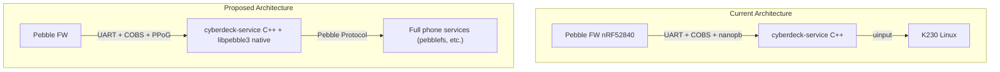
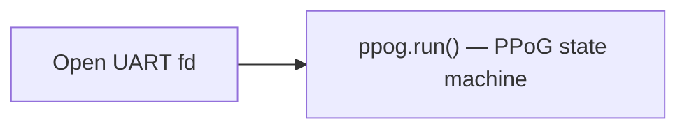

# Feasibility: libpebble3 on K230 as Pebble "Phone"

## Architecture Summary



### Current Protocol Stack
| Layer | nRF → K230 | K230 → nRF |
|-------|-----------|-----------|
| Application | [NrfToK230](file:///store/git/cyberdeck-service/src/pebble/k230_protocol.proto#10-17) (keyboard, touchpad, heartbeat) | [K230ToNrf](file:///store/git/cyberdeck-service/src/pebble/k230_protocol.proto#19-25) (ack, shutdown) |
| Serialization | nanopb (protobuf) | nanopb |
| Framing | COBS + CRC8 | COBS + CRC8 |
| Physical | UART 115200 | UART 115200 |

### Proposed Protocol Stack (Pebble Protocol over UART)
| Layer | Phone ↔ Firmware |
|-------|-----------------|
| Application | Pebble Protocol endpoints (AppMessage, BlobDB, system, custom) |
| Protocol | Pebble Protocol (4-byte header: len + endpoint) |
| Transport | PPoG (Data/Ack/Reset, seq numbering, windowed) |
| Framing | COBS (reusing existing framing) |
| Physical | UART 115200 (upgradeable, SPI available for bulk) |

---

## Q1: Can libpebble3 run on Linux as a native library?

**Yes.** The recommended approach is **GraalVM native-image** to compile the Kotlin JVM target into a native shared library that the C++ cyberdeck-service links against.

### What exists in jvmMain (already implemented)

The following `actual` declarations already have JVM implementations:

| File | Purpose | Status |
|------|---------|--------|
| [AppContext.jvm.kt](file:///store/git/cyberdeck-service/mobileapp/libpebble3/src/jvmMain/kotlin/io/rebble/libpebblecommon/connection/AppContext.jvm.kt) | Application context | ✅ JVM impl |
| [ConnectionFailureHandler.jvm.kt](file:///store/git/cyberdeck-service/mobileapp/libpebble3/src/jvmMain/kotlin/io/rebble/libpebblecommon/connection/ConnectionFailureHandler.jvm.kt) | Error handling | ✅ JVM impl |
| [PebbleDevice.jvm.kt](file:///store/git/cyberdeck-service/mobileapp/libpebble3/src/jvmMain/kotlin/io/rebble/libpebblecommon/connection/PebbleDevice.jvm.kt) | Device abstraction | ✅ JVM impl |
| [Database.jvm.kt](file:///store/git/cyberdeck-service/mobileapp/libpebble3/src/jvmMain/kotlin/io/rebble/libpebblecommon/database/Database.jvm.kt) | Room/SQLite | ✅ JVM impl |
| [LibPebbleModule.jvm.kt](file:///store/git/cyberdeck-service/mobileapp/libpebble3/src/jvmMain/kotlin/io/rebble/libpebblecommon/di/LibPebbleModule.jvm.kt) | DI module | ✅ JVM impl |
| Various util/web files | Filesystem, bitmaps, HTTP | ✅ JVM impl |

### What's stubbed (needs implementation for UART)

| File | What it does for BLE | What UART needs instead |
|------|---------------------|------------------------|
| [PebbleBle.jvm.kt](file:///store/git/cyberdeck-service/mobileapp/libpebble3/src/jvmMain/kotlin/io/rebble/libpebblecommon/connection/bt/ble/pebble/PebbleBle.jvm.kt) | `SERVER_META_RESPONSE` — the meta characteristic value the GATT server returns when the watch reads it (PPoG version, UUID, session type) | **Not needed** — UART has no GATT service discovery; version/session negotiation happens at the PPoG reset handshake level |
| [GattServer.jvm.kt](file:///store/git/cyberdeck-service/mobileapp/libpebble3/src/jvmMain/kotlin/io/rebble/libpebblecommon/connection/bt/ble/transport/GattServer.jvm.kt) | Opens a BLE GATT server, registers services/characteristics, sends notifications to the watch | **Not needed** — UART replaces the entire GATT layer |
| [KableBleScanner.jvm.kt](file:///store/git/cyberdeck-service/mobileapp/libpebble3/src/jvmMain/kotlin/io/rebble/libpebblecommon/connection/bt/ble/transport/impl/KableBleScanner.jvm.kt) | Scans for BLE devices | **Not needed** — UART is a fixed device path |
| [KableGattClient.jvm.kt](file:///store/git/cyberdeck-service/mobileapp/libpebble3/src/jvmMain/kotlin/io/rebble/libpebblecommon/connection/bt/ble/transport/impl/KableGattClient.jvm.kt) | GATT client (service discovery, MTU, pairing) | **Not needed** |
| [BluetoothState.jvm.kt](file:///store/git/cyberdeck-service/mobileapp/libpebble3/src/jvmMain/kotlin/io/rebble/libpebblecommon/connection/bt/BluetoothState.jvm.kt) | BLE adapter state | **Replace** with always-enabled stub |
| [Pairing.jvm.kt](file:///store/git/cyberdeck-service/mobileapp/libpebble3/src/jvmMain/kotlin/io/rebble/libpebblecommon/connection/bt/Pairing.jvm.kt) | BLE bonding | **Not needed** |

### How BLE transport differs from UART

The BLE flow in [PebbleBle.kt](file:///store/git/cyberdeck-service/mobileapp/libpebble3/src/commonMain/kotlin/io/rebble/libpebblecommon/connection/bt/ble/pebble/PebbleBle.kt) does this:


For UART, you only need the last step:



The **PPoG state machine** ([PPoG.kt](file:///store/git/cyberdeck-service/mobileapp/libpebble3/src/commonMain/kotlin/io/rebble/libpebblecommon/connection/bt/ble/ppog/PPoG.kt)) is transport-agnostic — it takes a [PPoGPacketSender](file:///store/git/cyberdeck-service/mobileapp/libpebble3/src/commonMain/kotlin/io/rebble/libpebblecommon/connection/bt/ble/ppog/PPoG.kt#L22-L25) interface:

```kotlin
interface PPoGPacketSender {
    suspend fun sendPacket(packet: ByteArray): Boolean
    fun wasRestoredWithSubscribedCentral(): Boolean  // BLE-specific, return false for UART
}
```

**What you need to implement:**
1. **`UartPPoGPacketSender`** — implements [PPoGPacketSender](file:///store/git/cyberdeck-service/mobileapp/libpebble3/src/commonMain/kotlin/io/rebble/libpebblecommon/connection/bt/ble/ppog/PPoG.kt#22-26), COBS-encodes and writes PPoG packets to UART fd
2. **`UartTransportConnector`** — implements [TransportConnector](file:///store/git/cyberdeck-service/mobileapp/libpebble3/src/commonMain/kotlin/io/rebble/libpebblecommon/connection/TransportConnector.kt#74-79), opens UART, spawns a reader coroutine that COBS-decodes incoming bytes into `PPoGStream.inboundPPoGBytesChannel`, then calls `ppog.run()`
3. **Koin DI wiring** — bind the UART implementations instead of BLE ones

---

## Q2: Firmware PPOUART Transport

**All BLE-specific complexity drops away.** The firmware needs a new `ppouart` module implementing `TransportImplementation`:

- Reuse existing [K230 UART driver](file:///store/git/cyberdeck-firmware/src/fw/drivers/k230/k230.c) (ISR-based byte receive, [k230_write_byte](file:///store/git/cyberdeck-firmware/src/fw/drivers/k230/k230.c#137-145) for TX)
- Reuse existing COBS framing to delimit PPoG packets
- Parse PPoG packet header (1-byte: `[SSSSSTTT]` — 5-bit sequence, 3-bit type)
- Implement Data/Ack/Reset state machine (simplified from [ppogatt.c](file:///store/git/cyberdeck-firmware/src/fw/comm/ble/kernel_le_client/ppogatt/ppogatt.c))
- Open `CommSession` via [comm_session_open()](file:///store/git/cyberdeck-firmware/src/fw/services/common/comm_session/session_transport.h#L99) after PPoG reset handshake

---

## Q3: Custom Endpoint vs AppMessage for Input Events

> [!IMPORTANT]
> **Recommendation: Use a custom Pebble Protocol endpoint** for keyboard and touchpad events. This gives the lowest latency path.

### Latency comparison

| Approach | Firmware path | Overhead |
|----------|-------------|----------|
| **Custom endpoint** | UART RX → PPoG → CommSession → endpoint callback (direct function call) | **Minimal** — 1 dispatch lookup in [protocol_endpoints_table.json](file:///store/git/cyberdeck-firmware/src/fw/services/common/comm_session/protocol_endpoints_table.json), then straight to your handler |
| **AppMessage** | UART RX → PPoG → CommSession → AppMessage endpoint (0x0030) → app UUID routing → app receive callback → key/value dictionary parsing | **Higher** — additional routing by app UUID, TLV dictionary decode, app context switch |

### Why custom endpoint is better for this use case

1. **No app UUID dependency** — AppMessage requires a running watchapp with a specific UUID to route to. A custom endpoint is always registered at the system level.
2. **No dictionary overhead** — AppMessage packs data into key/value TLV dictionaries. A custom endpoint receives raw bytes — you define whatever binary format you want (could even be your existing nanopb messages).
3. **Lower latency** — direct callback from the endpoint dispatch table, no additional routing layer.
4. **Bidirectional from day one** — the firmware can send to the custom endpoint and libpebble3 receives it; libpebble3 sends to the endpoint and firmware handles it.

### How to implement

**Firmware side:**
- Register a new endpoint (e.g. `0xCBD0` = "Cyberdeck" — pick an unused private ID) in [protocol_endpoints_table.json](file:///store/git/cyberdeck-firmware/src/fw/services/common/comm_session/protocol_endpoints_table.json)
- Write a `linux_comms_protocol_msg_callback()` handler that decodes incoming messages and dispatches key/touchpad events
- For outbound (FW→Linux): use `comm_session_send_data()` with your endpoint ID

**libpebble3 side:**
- Register a handler for your custom endpoint ID in the [PebbleProtocolHandler](file:///store/git/cyberdeck-service/mobileapp/libpebble3/src/commonMain/kotlin/io/rebble/libpebblecommon/connection/PebbleProtocolHandler.kt#13-19) message flow
- Send messages to that endpoint ID

> [!NOTE]
> **Future "Linux" app architecture:** When you eventually build the "Linux" watchapp, it can subscribe to `RawKeyboardEvents` via the system event service and forward them through the custom endpoint. The custom endpoint handler on the K230 side receives them and writes to uinput. This keeps the app logic on the firmware side (where the events originate) clean, while the transport is handled at the system level.

### AppMessage is still useful for
- Communication between specific watchapps and specific Linux applications
- The "pebblefs" notification bridge (Linux service → BlobDB → timeline pins/notifications)
- Third-party app communication

---

## Decisions Made

| Question | Decision |
|----------|----------|
| JVM on K230 | K230 has JVM. Build libpebble3 as GraalVM native-image, link to C++ service |
| UART framing | Use existing COBS to frame PPoG packets |
| Baud rate | 115200 sufficient. SPI available for bulk. Can increase later |
| Coexistence | Switch entirely to PPOUART during development |

---

## Implementation Phases

### Phase 1: Firmware PPOUART Transport
- Create `fw/comm/ppouart/ppouart.c` implementing `TransportImplementation`
- COBS-frame PPoG packets over existing K230 UART
- PPoG state machine (reset handshake, data/ack, windowed sequencing)
- Open `CommSession` on successful PPoG connection
- Register a custom endpoint (e.g. `0xCBD0`) for Linux input events
- **Effort:** ~400 lines C, referencing ppogatt.c

### Phase 2: libpebble3 UART Transport (K230 side)
- Implement `UartPPoGPacketSender` (COBS-encode, write to UART)
- Implement `UartTransportConnector` (COBS-decode reader, PPoG runner)
- Build libpebble3 JVM target → GraalVM native-image → link to C++ service
- Provide platform stubs (BluetoothState = always enabled, no pairing, etc.)
- Register handler for custom endpoint on libpebble3 side
- **Effort:** Medium-High (Kotlin + GraalVM + JNI/native integration)

### Phase 3: Replace K230 Protocol
- Remove [k230_manager.c](file:///store/git/cyberdeck-firmware/src/fw/services/common/k230_manager.c), [k230_protocol.proto](file:///store/git/cyberdeck-service/src/pebble/k230_protocol.proto), nanopb framing in cyberdeck-service
- Route keyboard/touchpad through custom PP endpoint
- Add K230→Pebble bidirectional messages
- Set up pebblefs endpoints for notifications, timeline, etc.
- **Effort:** Low once Phase 1+2 work
