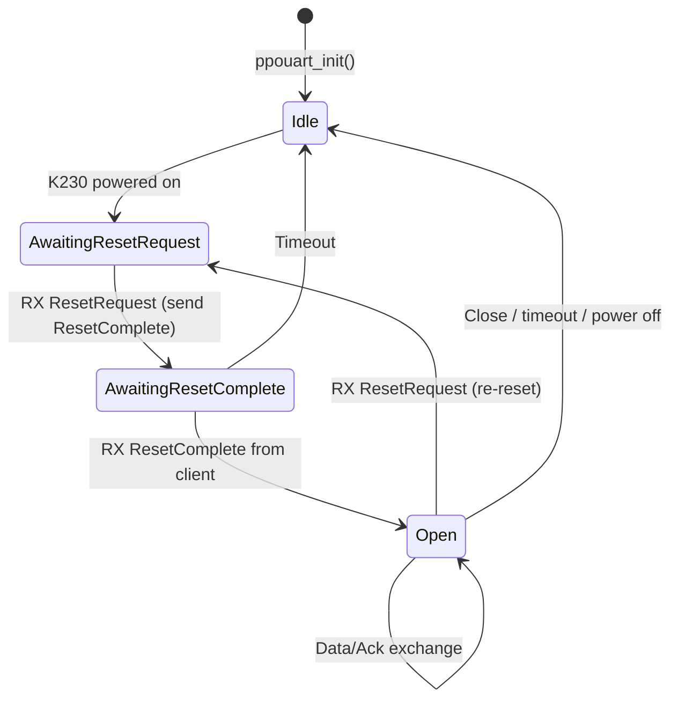

# Phase 1 Spec: PPOUART — Pebble Protocol over UART for K230

## Goal

Replace the custom COBS+nanopb protocol in the firmware's [k230_manager.c](file:///store/git/cyberdeck-firmware/src/fw/services/common/k230_manager.c) with a proper **PPoG (Pebble Protocol over Generic) transport** running over the **existing K230 UART**. This opens a full `CommSession` (Pebble Protocol session) between the nRF firmware and the K230 Linux service, enabling the same endpoint-based messaging that currently runs over BLE to a phone.

After this phase, the firmware treats the K230 UART as a "phone" — sending and receiving Pebble Protocol messages via `CommSession`.

---

## Background & Architecture

### Current state

```
nRF Firmware ←── custom COBS+CRC8+nanopb ──→ K230 Linux (cyberdeck-service C++)
```

- [k230_manager.c](file:///store/git/cyberdeck-firmware/src/fw/services/common/k230_manager.c) — 428-line module handling the entire K230 protocol
- [k230.c](file:///store/git/cyberdeck-firmware/src/fw/drivers/k230/k230.c) — low-level UART driver (DMA RX buffer, byte-by-byte ISR callback, synchronous [k230_write_byte](file:///store/git/cyberdeck-firmware/src/fw/drivers/k230/k230.c#137-145) TX)
- Protocol: nanopb-serialized [NrfToK230](file:///store/git/cyberdeck-service/src/pebble/k230_protocol.proto#10-17) / [K230ToNrf](file:///store/git/cyberdeck-service/src/pebble/k230_protocol.proto#19-25) messages, COBS framed, CRC8 checksum
- Only handles: keyboard events, touchpad events, heartbeat, ack, shutdown

### Target state

```
nRF Firmware ←── COBS-framed PPoG packets ──→ K230 Linux (libpebble3 native)
                     │
               CommSession opened
                     │
              Full Pebble Protocol
         (endpoints, AppMessage, BlobDB, etc.)
```

### What PPoG is

PPoG is the **transport-agnostic reliable delivery protocol** that Pebble uses between a phone and watch firmware. It provides:
- Packet sequencing (5-bit sequence numbers, modulo 32)
- Windowed acknowledgments
- Reset handshake for session negotiation
- Retransmission on timeout

Currently PPoG runs over BLE GATT (called "PPoGATT"). This spec defines **PPOUART** — the same protocol over UART with COBS framing.

---

## Reference Code Map

### Files to study (READ these before implementing)

| File | Purpose | Key things to note |
|------|---------|-------------------|
| [ppogatt.c](file:///store/git/cyberdeck-firmware/src/fw/comm/ble/kernel_le_client/ppogatt/ppogatt.c) | **Primary reference** — 1300-line BLE PPoG implementation | Study: state machine, [prv_send_next_packets](file:///store/git/cyberdeck-firmware/src/fw/comm/ble/kernel_le_client/ppogatt/ppogatt.c#1172-1211), [prv_handle_data_notification](file:///store/git/cyberdeck-firmware/src/fw/comm/ble/kernel_le_client/ppogatt/ppogatt.c#668-707), [prv_enter_awaiting_reset_complete](file:///store/git/cyberdeck-firmware/src/fw/comm/ble/kernel_le_client/ppogatt/ppogatt.c#444-499), [prv_handle_reset_complete](file:///store/git/cyberdeck-firmware/src/fw/comm/ble/kernel_le_client/ppogatt/ppogatt.c#553-601) (opens CommSession), `s_ppogatt_transport_implementation` vtable at line 196 |
| [ppogatt_internal.h](file:///store/git/cyberdeck-firmware/src/fw/comm/ble/kernel_le_client/ppogatt/ppogatt_internal.h) | PPoG packet format, constants, types | `PPoGATTPacket` struct (1-byte header), `PPoGATTPacketType` enum, window sizes, timeout values |
| [session_transport.h](file:///store/git/cyberdeck-firmware/src/fw/services/common/comm_session/session_transport.h) | **Transport abstraction** — the interface you must implement | `TransportImplementation` struct (function pointers), `comm_session_open()`, `comm_session_close()`, `comm_session_receive_router_write()`, send queue API |
| [session.h](file:///store/git/cyberdeck-firmware/src/fw/services/common/comm_session/session.h) | CommSession public API | `comm_session_send_data()` for outbound messages, session types, capabilities |
| [session_analytics.h](file:///store/git/cyberdeck-firmware/src/fw/services/common/comm_session/session_analytics.h) | Transport type enum | Add `CommSessionTransportType_PPOUART = 5` |
| [k230_manager.c](file:///store/git/cyberdeck-firmware/src/fw/services/common/k230_manager.c) | **Module being replaced** — study for COBS/UART patterns to reuse | COBS RX callback pattern ([prv_uart_rx_callback](file:///store/git/cyberdeck-firmware/src/fw/services/common/k230_manager.c#185-212)), TX pattern ([prv_send_message](file:///store/git/cyberdeck-firmware/src/fw/services/common/k230_manager.c#55-91)), lifecycle (init, power on/off), prompt commands |
| [k230.h](file:///store/git/cyberdeck-firmware/src/fw/drivers/k230/k230.h) / [k230.c](file:///store/git/cyberdeck-firmware/src/fw/drivers/k230/k230.c) | UART driver — **reuse as-is** | [k230_register_character_callback()](file:///store/git/cyberdeck-firmware/src/fw/drivers/k230/k230.c#48-51) for ISR RX, [k230_write_byte()](file:///store/git/cyberdeck-firmware/src/fw/drivers/k230/k230.c#137-145) for TX, DMA buffer is 1024 bytes |
| [cobs.h](file:///store/git/cyberdeck-firmware/src/fw/console/cobs.h) | COBS framing API — **reuse as-is** | `cobs_streaming_decode_start/decode/finish` for RX, `cobs_encode()` for TX, `MAX_SIZE_AFTER_COBS_ENCODING()` macro |

### Files to modify

| File | Change |
|------|--------|
| [session_analytics.h](file:///store/git/cyberdeck-firmware/src/fw/services/common/comm_session/session_analytics.h) | Add `CommSessionTransportType_PPOUART = 5` to the enum |
| [k230_manager.h](file:///store/git/cyberdeck-firmware/src/fw/services/common/k230_manager.h) / [k230_manager.c](file:///store/git/cyberdeck-firmware/src/fw/services/common/k230_manager.c) | Replace nanopb protocol with PPOUART transport. **Keep** lifecycle/display/prompt APIs. The header API may need updates but display control, power control, and prompt commands should remain |

### Files to create

| File | Purpose |
|------|---------|
| `src/fw/comm/ppouart/ppouart.h` | PPOUART public API (create, init, destroy) |
| `src/fw/comm/ppouart/ppouart.c` | Core PPOUART implementation: PPoG state machine, COBS framing, CommSession integration |

> [!NOTE]
> Alternatively, the PPOUART logic can live directly in the refactored [k230_manager.c](file:///store/git/cyberdeck-firmware/src/fw/services/common/k230_manager.c) if a separate module feels over-engineered. The key requirement is that the code implements `TransportImplementation` and opens a `CommSession`. The agent should use their judgment — but separating transport from manager (lifecycle/display) is cleaner.

---

## PPoG Packet Wire Format

Each PPoG packet is a byte array. The first byte is the header:

```
Bit layout: [SSSSS TTT]
  - TTT   (bits 0-2): Packet type
  - SSSSS (bits 3-7): Sequence number (0-31)
```

### Packet types

| Type | Value | Payload | Direction | Purpose |
|------|-------|---------|-----------|---------|
| Data | `0b000` | Pebble Protocol bytes | Both | Carries PP data fragments |
| Ack | `0b001` | None | Both | Acknowledges receipt up to SN |
| ResetRequest | `0b010` | `[version_byte]` | Initiator→Responder | Start/restart session |
| ResetComplete | `0b011` | `[rx_window, tx_window]` (v1) | Responder→Initiator | Session established |

Reference: [ppogatt_internal.h](file:///store/git/cyberdeck-firmware/src/fw/comm/ble/kernel_le_client/ppogatt/ppogatt_internal.h#L39-L55)

```c
// From ppogatt_internal.h — reuse these definitions
typedef enum {
  PPoGATTPacketTypeData = 0x0,
  PPoGATTPacketTypeAck = 0x1,
  PPoGATTPacketTypeResetRequest = 0x2,
  PPoGATTPacketTypeResetComplete = 0x3,
} PPoGATTPacketType;

typedef struct PACKED {
  PPoGATTPacketType type:3;
  uint8_t sn:5;
  uint8_t payload[];
} PPoGATTPacket;
```

> [!TIP]
> You can reuse (or `#include`) the existing `PPoGATTPacket` struct and `PPoGATTPacketType` enum from [ppogatt_internal.h](file:///store/git/cyberdeck-firmware/src/fw/comm/ble/kernel_le_client/ppogatt/ppogatt_internal.h). Consider moving these common types to a shared header like `ppog_packet.h` if you want clean separation, or just reference the existing header.

---

## UART Framing: COBS-delimited PPoG packets

Over BLE, each GATT notification is naturally one PPoG packet. Over UART, we use COBS to delimit packets:

```
Wire format per PPoG packet:
  0x00 | COBS_ENCODE(ppog_header + ppog_payload) | 0x00
  ^^^                                              ^^^
  leading delimiter                         trailing delimiter
```

- Use the **same COBS framing** from [cobs.h](file:///store/git/cyberdeck-firmware/src/fw/console/cobs.h) that [k230_manager.c](file:///store/git/cyberdeck-firmware/src/fw/services/common/k230_manager.c) already uses
- **No CRC**: PPoG has its own sequence-number-based integrity (data can be resent on ack timeout). The UART is a short internal on-board link with negligible error rate. If CRC is desired later, it can be added as a future enhancement.
- **No nanopb**: The content of Data packets is raw Pebble Protocol bytes, not protobuf

### Maximum packet size

- PPoG Data payload max = configurable, but typically limited by BLE MTU. Over UART, we can choose a larger limit
- Recommended: **256 bytes** of PP data per PPoG Data packet. This keeps COBS overhead small and fits comfortably in buffers
- With PPoG header (1 byte) + 256 bytes data = 257 bytes raw, COBS overhead ≈ 2 bytes = ~259 bytes on wire
- Total with delimiters: ~261 bytes per COBS frame

Define as:
```c
#define PPOUART_MAX_PP_PAYLOAD_SIZE 256
#define PPOUART_MAX_PACKET_SIZE (1 + PPOUART_MAX_PP_PAYLOAD_SIZE)  // header + data
#define PPOUART_RX_BUFFER_SIZE MAX_SIZE_AFTER_COBS_ENCODING(PPOUART_MAX_PACKET_SIZE)
```

---

## State Machine

Implement a simplified version of the PPoGATT state machine. The firmware acts as the **PPoG server** (the K230/libpebble3 acts as the client and initiates the reset handshake).



### Reset handshake (simplified for UART)

1. K230 boots, libpebble3 sends **ResetRequest** `[version=1]`
2. Firmware receives ResetRequest, sends **ResetComplete** `[rx_window, tx_window]`
3. K230/libpebble3 sends **ResetComplete** `[rx_window, tx_window]`
4. Firmware opens `CommSession` — session is now active

For V1 protocol, the ResetComplete carries window sizes for negotiation. For simplicity, start with V0-compatible fixed windows:

```c
#define PPOUART_WINDOW_SIZE 4  // same as PPOGATT_V0_WINDOW_SIZE
```

### Data flow

**Inbound (K230 → Firmware):**
1. UART ISR receives bytes → COBS streaming decode in [prv_uart_rx_callback](file:///store/git/cyberdeck-firmware/src/fw/services/common/k230_manager.c#185-212)
2. On `0x00` delimiter → COBS frame complete → `system_task_add_callback_from_isr` to process
3. Parse `PPoGATTPacket` header from decoded bytes
4. If Data: check sequence number, forward payload to `comm_session_receive_router_write()`
5. Schedule ack if needed (batched, with `PPOUART_MAX_DATA_ACK_LATENCY_MS` timer)

**Outbound (Firmware → K230):**
1. `CommSession` calls [send_next](file:///store/git/cyberdeck-firmware/src/fw/comm/ble/kernel_le_client/ppogatt/ppogatt.c#1229-1240) (your `TransportImplementation.send_next`)
2. Read bytes from `comm_session_send_queue_copy()`
3. Package into `PPoGATTPacket` with Data type + next sequence number
4. COBS encode + write via [k230_write_byte()](file:///store/git/cyberdeck-firmware/src/fw/drivers/k230/k230.c#137-145)
5. Track in-flight packets for ack

### Sequence numbering

- 5-bit sequence numbers: 0-31 (modulo 32)
- Window size limits how many unacked packets can be in flight
- Ack SN = "I've received everything up to and including this SN"
- On ack timeout, resend all in-flight packets

Reference: see [ppogatt.c `prv_send_next_packets`](file:///store/git/cyberdeck-firmware/src/fw/comm/ble/kernel_le_client/ppogatt/ppogatt.c#L1172-L1210) and [prv_sn_distance](file:///store/git/cyberdeck-firmware/src/fw/comm/ble/kernel_le_client/ppogatt/ppogatt.c#L215-L220)

---

## TransportImplementation

Register a `TransportImplementation` struct, mirroring the one at [ppogatt.c:196](file:///store/git/cyberdeck-firmware/src/fw/comm/ble/kernel_le_client/ppogatt/ppogatt.c#L196-L203):

```c
static const TransportImplementation s_ppouart_transport_implementation = {
  .send_next = ppouart_send_next,   // Read from CommSession send queue, packetize, TX
  .close = ppouart_close,           // Close session, reset state
  .reset = ppouart_reset,           // Re-initiate reset handshake
  .set_connection_responsiveness = NULL, // Not applicable for UART
  .get_uuid = NULL,                 // No UUID for UART transport
  .get_type = ppouart_get_type,     // Return CommSessionTransportType_PPOUART
};
```

### send_next implementation

This is the core outbound path. Reference [ppogatt.c `prv_send_next_packets`](file:///store/git/cyberdeck-firmware/src/fw/comm/ble/kernel_le_client/ppogatt/ppogatt.c#L1172-L1210):

```
1. Check for priority packets (pending ack, pending reset)
2. If no priority packets, check CommSession send queue:
   - comm_session_send_queue_get_length() > 0?
   - Can send? (next_data_sn - next_expected_ack_sn < window_size)
3. comm_session_send_queue_copy() up to PPOUART_MAX_PP_PAYLOAD_SIZE bytes
4. Build PPoGATTPacket: type=Data, sn=next_data_sn++
5. COBS encode: 0x00 + cobs_encode(packet) + 0x00
6. Write bytes via k230_write_byte()
7. comm_session_send_queue_consume() the bytes we sent
8. Track payload size for retransmission
9. Loop if more data and window permits (cap loop count to avoid blocking)
```

### Opening CommSession

After the reset handshake completes (mirroring [ppogatt.c:553-600](file:///store/git/cyberdeck-firmware/src/fw/comm/ble/kernel_le_client/ppogatt/ppogatt.c#L553-L600)):

```c
CommSession *session = comm_session_open(
    (Transport *)&s_ppouart_state,     // opaque transport pointer
    &s_ppouart_transport_implementation,
    TransportDestinationHybrid         // carries both system + app PP traffic
);
```

---

## Module Structure

### ppouart.h

```c
#pragma once

// Lifecycle — called from k230_manager
void ppouart_create(void);
void ppouart_destroy(void);

// Call when K230 UART is ready to receive
void ppouart_start(void);

// Call when K230 is powering off
void ppouart_stop(void);

// UART character callback — register with k230_register_character_callback()
void ppouart_uart_rx_char(char c, bool *should_context_switch);

// Stats (for prompt commands)
void ppouart_get_stats(uint32_t *tx_frames, uint32_t *rx_frames,
                       uint32_t *cobs_errors, uint32_t *ack_timeouts);
void ppouart_reset_stats(void);
```

### ppouart.c internal state

```c
typedef enum {
  PPOUARTState_Idle,
  PPOUARTState_AwaitingResetRequest,
  PPOUARTState_AwaitingResetComplete,
  PPOUARTState_Open,
} PPOUARTState;

static struct {
  PPOUARTState state;

  // RX COBS buffer
  uint8_t rx_buffer[PPOUART_RX_BUFFER_SIZE];
  CobsDecodeContext cobs_ctx;
  bool frame_in_progress;
  volatile bool frame_pending_process;

  // Sequence state
  uint8_t in_next_expected_sn;      // Next expected inbound data SN
  uint8_t out_next_data_sn;         // Next outbound data SN to assign
  uint8_t out_next_expected_ack_sn; // Oldest unacked outbound SN
  uint16_t out_payload_sizes[32];   // Track payload sizes for retransmission

  // Window
  uint8_t tx_window_size;
  uint8_t rx_window_size;

  // Ack state
  uint8_t outstanding_rx_ack_count;
  bool send_rx_ack_now;
  TimerID rx_ack_timer;
  TimerID ack_timeout_timer;
  uint8_t timeout_counter;

  // CommSession
  CommSession *session;

  // Stats
  uint32_t tx_frames;
  uint32_t rx_frames;
  uint32_t cobs_errors;
  uint32_t ack_timeouts;
} s_ppouart;
```

---

## Integration with k230_manager

The refactored [k230_manager.c](file:///store/git/cyberdeck-firmware/src/fw/services/common/k230_manager.c) should:

1. **Keep** all lifecycle/display/power/prompt APIs untouched
2. **Replace** the protocol (COBS+nanopb) with PPOUART:
   - [k230_manager_init()](file:///store/git/cyberdeck-firmware/src/fw/services/common/k230_manager.c#284-289) → call `ppouart_create()`, register `ppouart_uart_rx_char` with [k230_register_character_callback()](file:///store/git/cyberdeck-firmware/src/fw/drivers/k230/k230.c#48-51)
   - [k230_manager_power_on()](file:///store/git/cyberdeck-firmware/src/fw/services/common/k230_manager.c#290-304) → power on K230, call `ppouart_start()`
   - [k230_manager_power_off()](file:///store/git/cyberdeck-firmware/src/fw/services/common/k230_manager.c#305-312) → call `ppouart_stop()`, power off K230
3. **Remove** [k230_manager_send_keyboard_event](file:///store/git/cyberdeck-firmware/src/fw/services/common/k230_manager.c#92-104), [k230_manager_send_touchpad_event](file:///store/git/cyberdeck-firmware/src/fw/services/common/k230_manager.c#105-118), [k230_manager_send_heartbeat](file:///store/git/cyberdeck-firmware/src/fw/services/common/k230_manager.c#119-125) — these message types no longer exist at the manager level (they'll be handled via PP endpoints later in Phase 3)
4. **Keep** key forwarding logic but have it use `comm_session_send_data()` instead of nanopb (or defer this to Phase 3 and just disable key forwarding for now)
5. **Update** prompt commands:
   - [command_k230_stats](file:///store/git/cyberdeck-firmware/src/fw/services/common/k230_manager.c#410-418) → show PPOUART stats instead of old protocol stats
   - Keep [command_k230_state](file:///store/git/cyberdeck-firmware/src/fw/services/common/k230_manager.c#397-409), `command_k230_on/off`, display commands

---

## Key Differences from PPoGATT to Simplify

The PPOUART implementation is much simpler than PPoGATT because:

| PPoGATT complexity | PPOUART equivalent |
|---|---|
| Multiple concurrent clients (linked list) | **Single client** — one K230, one session |
| GATT service discovery + characteristic lookup | **None** — fixed UART |
| MTU negotiation (affects payload size) | **Fixed** — use 256 byte max payload |
| BLE connection/disconnection events | **Power on/off** — explicit lifecycle |
| `bt_lock()` synchronization | **Simpler** — ISR→system_task callback pattern (already established in k230_manager.c) |
| Meta characteristic read (version + UUID) | **Embedded in ResetRequest** — version byte in payload |
| Multiple transport destinations per client | **Single** — `TransportDestinationHybrid` |
| BLE write-without-response flow control | **None** — UART TX is synchronous |
| Disconnect counter / analytics | **Optional** — add basic stats |

---

## Timeouts & Constants

Reuse or adapt from [ppogatt_internal.h](file:///store/git/cyberdeck-firmware/src/fw/comm/ble/kernel_le_client/ppogatt/ppogatt_internal.h#L14-L32):

```c
#define PPOUART_WINDOW_SIZE          4       // Start with V0-compatible window
#define PPOUART_SN_BITS              5
#define PPOUART_SN_MOD               (1 << PPOUART_SN_BITS)  // 32
#define PPOUART_MAX_PP_PAYLOAD_SIZE  256
#define PPOUART_ACK_LATENCY_MS       100     // Max time before sending batched ack
#define PPOUART_ACK_TIMEOUT_MS       6000    // Timeout for unacked outbound packets
#define PPOUART_MAX_RETRIES          2       // Max retries before reset
#define PPOUART_RESET_TIMEOUT_MS     10000   // Timeout waiting for ResetComplete
```

---

## CommSessionTransportType Registration

In [session_analytics.h](file:///store/git/cyberdeck-firmware/src/fw/services/common/comm_session/session_analytics.h#L19-L24), add:

```diff
 typedef enum {
   CommSessionTransportType_PlainSPP = 0,
   CommSessionTransportType_iAP = 1,
   CommSessionTransportType_PPoGATT = 2,
   CommSessionTransportType_QEMU = 3,
   CommSessionTransportType_PULSE = 4,
+  CommSessionTransportType_PPOUART = 5,
 } CommSessionTransportType;
```

---

## Build System

The firmware uses waf (wscript files) for building. Source files in `src/fw/services/common/` and `src/fw/comm/` are auto-globbed or explicitly listed depending on the target. Check the relevant wscript files for the cyberdeck board to ensure new files are picked up.

Reference: existing ppogatt test setup in [tests/fw/comm/wscript:167-180](file:///store/git/cyberdeck-firmware/tests/fw/comm/wscript#L167-L180)

---

## Verification Plan

### 1. Build verification

Build the firmware for the Cyberdeck target and ensure no compilation errors:
```bash
# From cyberdeck-firmware root
python waf configure --board=cyberdeck
python waf build
```

### 2. QEMU testing

If the `silk_cyberdeck` QEMU target is functional, test the PPOUART module in QEMU:
- Power on K230 via prompt: `k230 on`
- Verify PPOUART enters `AwaitingResetRequest` state: `k230 state`
- Simulate a ResetRequest from the "K230 side" (may need a test harness writing to the QEMU UART)
- Verify stats: `k230 stats`

### 3. Unit tests

Create tests following the pattern in [tests/fw/comm/wscript:167-180](file:///store/git/cyberdeck-firmware/tests/fw/comm/wscript#L167-L180):

- Test PPoG packet parsing (Data, Ack, ResetRequest, ResetComplete)
- Test COBS framing round-trip (encode → decode → verify)
- Test state machine transitions (Idle → AwaitingReset → Open)
- Test sequence number wraparound (SN 31 → 0)
- Test window management (can't send more than window_size unacked packets)
- Test ack processing (receiving ack advances send window)

### 4. Integration test with K230

This is the definitive test but requires both firmware and K230-side changes (Phase 2). For Phase 1 alone:
- Verify the PPOUART module compiles and initializes
- Verify prompt commands report correct state/stats
- Verify the K230 UART driver still works (bytes flow in/out)
- Send raw PPoG ResetRequest bytes from the K230 side (can be done with a simple test tool that writes COBS-encoded PPoG packets to `/dev/ttyS2`) and verify the firmware responds with ResetComplete

---

## Out of Scope for Phase 1

- **Custom PP endpoint for keyboard/touchpad** — this is Phase 3 (after libpebble3 integration)
- **libpebble3 UART transport** — this is Phase 2
- **Key forwarding via PP** — defer to Phase 3; key forwarding can be disabled during Phase 1
- **V1 window negotiation** — start with fixed V0 windows; add V1 support later if needed
- **PPoG version negotiation** — accept version 0 or 1 from the client, but always use V0-compatible behavior initially
